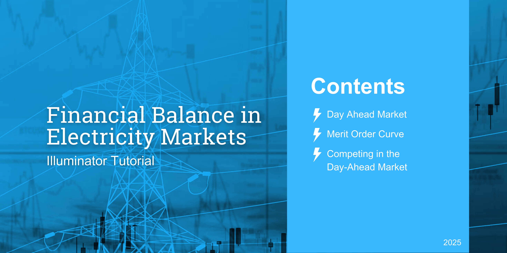

## Practical Financial Balance in Electricity Markets

This tutorial mimics a single hour of the European Day-Ahead Market. Three companies (four in the last task) bid their power plants in a single price auction, and the demand is completely inelastic (set to a fixed value). Bids are based on marginal costs (fuel, CO2 emissions and variable O&M), so they form the merit order that sets the market clearing price.

- **Task 1**: Day-Ahead Market with conventional generation.
- **Task 2**: Day-Ahead Market with added wind and solar capacity.
- **Task 3**: Compete in the Day-Ahead Market as a fourth company with your own bidding strategy.
