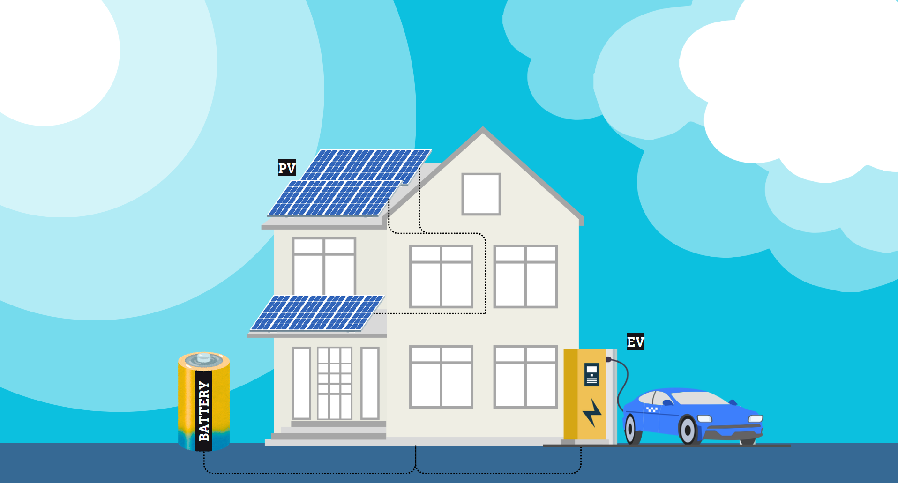

## Residential Energy System

This tutorial simulates a single house with an electric vehicle (EV), a photovoltaic (PV) installation and a battery. You run scenarios for different days of the year and explore how the sizing of the PV and the battery affects how much the house depends on the grid.

The scenario is defined in `data/Tutorial4.yaml`. It demonstrates:
- `CSV` models that read the household load, the EV presence and the weather data for the PV model.
- The `Load`, `PV`, `EV` and `Battery` models, connected to a `Controller_T4` model that decides how much power flows to or from the battery.
- Changing a scenario from Python with `set_scenario_param` (the simulated day) and `set_model_param` (the size of the components).
